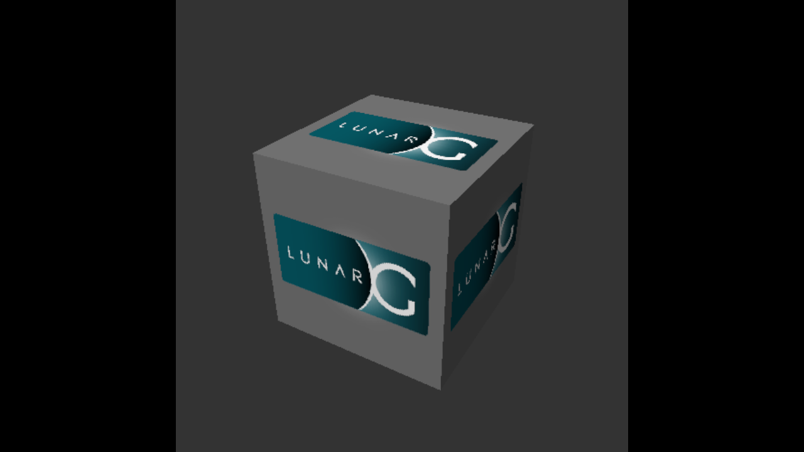

# krun-gaming

Windows games from your Steam library on an Apple Silicon Mac, in a Linux microVM, the way a Steam Deck runs them.
A small launcher on [libkrun](https://github.com/libkrun/libkrun) (Hypervisor.framework) boots a Fedora 44 guest
that runs Valve's ARM64 Steam client in Big Picture mode under gamescope. Games run through Valve's Proton 11.0
(ARM64), which emulates x86 game code with [FEX](https://github.com/FEX-Emu/FEX), with DXVK (D3D9–11) and
vkd3d-proton (D3D12) on Vulkan.
The guest's Vulkan reaches the Mac GPU through Venus, virglrenderer and Mesa's
[KosmicKrisp](https://docs.mesa3d.org/drivers/kosmickrisp.html) (Vulkan on Metal). No Windows, no Rosetta, no
Docker, and no closed-source translation layer.

**Status: 0.1.0, a working prototype.** Expect rough edges; see [known limits](#known-limits).

## What works

Measured 2026-11-08/09 on a MacBook Pro M1 Pro with 16 GB, macOS 27.0.1. Details and how each result was measured are in the
[lab notes](notes/LAB-NOTES.md).

| | Result |
|---|---|
| Steam | Valve's native ARM64 client in Big Picture under gamescope, in a Mac window at 2560x1440 (1 guest pixel per Retina pixel) |
| Steam UI | ~50 fps while navigating, with Chromium's GPU compositing. Idle: host ~83 % CPU, ~3 GB RSS |
| Setup | `bash setup.sh` from an empty cache in 21 minutes (fresh clone, 2026-11-09) |
| D3D11 | Banished (DXVK) at 60 fps (the display rate) at 2560x1440 on Proton 11.0 (ARM64); Play → game window in ≤ 16 s |
| D3D12 | vkd3d-proton v3.1 test suite: 544 of 588 tests without a failed check, stream output (transform feedback) included. InfraSpace (Unity, `-force-d3d12`) renders its menus |
| Shared textures | Textures shared between Wine processes (D3DKMT) work: InfraSpace's Media Foundation intro video plays (D3D11 mode). Our own guest Venus driver + an MTLHeap-sharing virglrenderer patch |
| Microphone | the Mac's default input reaches the guest (virtio-snd capture → PipeWire) |
| Downloads | Steam downloads at the line's full rate (49–53 Mbit/s on a 50 Mbit/s line) |
| Startup | a loader in the window shows the guest's boot stage until Steam's first frame |
| Input | keyboard and absolute mouse (virtio-input); one cursor (gamescope's) |
| Sound | virtio-snd → CoreAudio, PipeWire in the guest; plays on the Mac's default output |
| Vulkan in the guest | Vulkan 1.4 with swapchain on the M1 Pro (Venus → KosmicKrisp → Metal) |



## Requirements

- An Apple Silicon Mac. Only an M1 Pro with 16 GB on macOS 27.0.1 has been tested.
- Xcode, [Homebrew](https://brew.sh), [rustup](https://rustup.rs) and Node 26.
- A Steam account and the games you own. Nothing is bundled.

## Quick start

```bash
bash setup.sh             # builds everything into ~/.local/share/krun-gaming (override: KRUN_GAMING_CACHE)
sh run-session.sh         # Steam Big Picture under gamescope in a Mac window
sh guest-cmd.sh 'ps aux'  # command channel into the running session (--root for root)
```

`setup.sh` skips every step whose output already exists. Log in to Steam in the window, install a game, play.
`DISPLAY_SIZE=WxH sh run-session.sh` sets the guest resolution. Logs go to `/tmp/kg-steam.log` and
`~/.local/share/krun-gaming/out/`.

## How it works

```
macOS host   launcher (vm-gpu.m: libkrun + HVF) ── AppKit window (IOSurface), CoreAudio, keyboard/mouse
               │ virtio-gpu Venus → virglrenderer (UTM fork) → KosmicKrisp (Mesa) → Metal
Linux guest  Fedora 44, kernel 7.3.3 + Asahi TSO patches
               └ gamescope → Steam (ARM64) → FEX → Proton → DXVK / vkd3d-proton → Vulkan (Mesa Venus)
```

Everything is built from source at pinned commits by `setup.sh`:

- `build-host.sh`: the host stack.
- `kernel/`: the guest kernel.
- `prepare-guest.ts`: the guest disk.
- `guest/`: in-guest scripts for provisioning, the Steam session and tests.

Fixes are local patches, listed in [NOTICE](NOTICE.md):
- `host-patches/`: KosmicKrisp, virglrenderer, libkrun.
- `guest-patches/`: gamescope, the guest's Venus driver.
- `kernel/patches/`: virtio-gpu.

| Path | Purpose |
|---|---|
| `setup.sh`, `build-host.sh`, `prepare-guest.ts`, `kernel/` | build everything |
| `vm-gpu.m`, `input-mac.m`, `net-slirp.c` | the launcher: VM, display window, input, network (libslirp) |
| `run-session.sh`, `guest-cmd.sh`, `guest/steam-*.sh` | the Steam session and its command channel |
| `host-tests/` | small repros behind the results in the lab notes |
| `notes/LAB-NOTES.md` | research log: every result, how it was measured |

## Known limits

- **D3D12:** some edge-case tests of the suite still fail: texture reinterpretation, border colours, tessellation edge cases, 16 KB suballocation alignment.
- **Steam UI:** Valve's GL composer in the webhelper runs on llvmpipe (CPU).
- **Static game windows:** a launcher that draws only once can stay behind Steam's loading spinner; click into it or press a key.
- **Anti-cheat:** games whose anti-cheat refuses VMs will not run.

See the [changelog](CHANGELOG.md) for the release notes.

## Legal

Bring your own games: krun-gaming only runs Valve's Steam client, which downloads games you own. This project is not
affiliated with or endorsed by Valve, Apple, CodeWeavers or Parallels. Steam and Proton are trademarks of Valve
Corporation.

## License

[MIT](LICENSE) for the code in this repository. The patches in `host-patches/`, `guest-patches/` and `kernel/patches/`
are under the licenses of the projects they modify; see [NOTICE](NOTICE.md).
