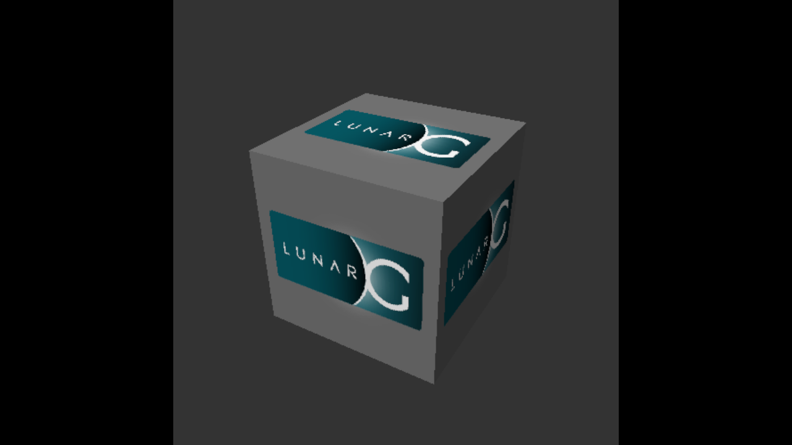

# Lab notes: Windows games in a libkrun microVM on macOS

The project's research log (2026-11-07/08): every result with how it was measured. The public overview is the
[README](../README.md). Paths below are relative to the repository root. Stack:
libkrun (HVF) → virtio-gpu Venus → virglrenderer → KosmicKrisp → Metal; guest Fedora 44 + gamescope + FEX + Steam/Proton.

Host: MacBook Pro M1 Pro, 16 GB, macOS 27.0.1. Everything lands in `~/.local/share/krun-gaming/` (not `~/Library/Caches`: macOS purged it on 2026-11-08) (override with
`KRUN_GAMING_CACHE`); system-wide only Homebrew packages.

**Constraints (2026-11-07):** own minimal stack, **no Docker, no Rosetta**, minimal footprint; take pieces
**directly from Asahi Linux, UTM and upstream**, third-party work only where nothing upstream exists (see
[NOTICE](../NOTICE.md)).

## Status (2026-11-08)

| Goal | Status |
|---|---|
| Vulkan on the Mac GPU in the guest, swapchain, picture in a Mac window | **done**: Venus → KosmicKrisp → Metal, IOSurface window |
| Steam (native ARM64 client) in Big Picture under **gamescope** | **done**: flicker fixed (gamescope 0001), network status via NetworkManager |
| D3D9–11 games (Proton + DXVK under FEX) | **playable at 60 fps**: Banished (D3D11) at 2560x1440 (kernel HZ=1000 + preemption) |
| D3D12 (vkd3d-proton) | **test suite: 544/588 without failures**, stream output captured (KK 0004); InfraSpace (Unity, `-force-d3d12`): menus and input work; its Media Foundation video stays black (D3D11 too): KosmicKrisp images are not exportable for sharing |
| Input | keyboard + absolute mouse (gamescope 0002); mouse reached the game in a user session |
| Audio | **works**: virtio-snd → CoreAudio (libkrun 0010) + PipeWire, heard on the Mac's default output (listening test, 2026-11-08) |

## Quick start

```bash
bash setup.sh             # everything into ~/.local/share/krun-gaming (Xcode, Homebrew, rustup, Node 26)
sh run-session.sh         # Steam Big Picture under gamescope in a Mac window (2560x1440 = 1280x720 points)
sh guest-cmd.sh 'ps aux'  # command channel into the running session (--root for root)
```

`DISPLAY_SIZE=WxH` sets the guest resolution (default 2560x1440, 1 guest pixel per Retina pixel). Idle Steam UI 75 s
after start (measured 2026-11-08, one 10 s sample each): **host 83 % CPU, 3.0 GB RSS** at native resolution (UI
fully loaded, checked in the snapshot); with `--env RENDER_W/RENDER_H` (gamescope upscaling) 1280x720 and 1920x1080
both 173 % (load state not checked), so native stays the default. Log in to Steam in the window, install a game, play. Logs: `/tmp/kg-steam.log`, `~/.local/share/krun-gaming/out/steam-*.txt`.

## Result: picture in a Mac window (measured 2026-11-08)



Path: vkcube (Vulkan, Xwayland) → **gamescope** 3.16.29 (Fedora, DRM backend, Vulkan composition) → KMS
`SET_SCANOUT_BLOB` on virtio-gpu → libkrun (patch 0008) → launcher display backend → IOSurface → `CALayer` of an
AppKit window. GPU: Venus → UTM virglrenderer → **KosmicKrisp** (Mesa) → Metal on the M1 Pro. No video encoding.
15 s run (`guest/gamescope-test.sh`): **>800 frames presented (~55 FPS)**, clean shutdown. Snapshot via `VM_SNAPSHOT=/path.ppm`.

Driver comparison (vkmark headless 1280×720, one run each): **KosmicKrisp 4062** vs UTM MoltenVK 3535. MoltenVK
also cannot compile gamescope's compute shader (SPIRV-Cross, Y'CbCr sampler arrays with argument buffers).

What it took, each found from a failing run (logs: `VM_LOG=4` shows virglrenderer's messages through libkrun):

| Failure | Cause | Fix (own, local) |
|---|---|---|
| KosmicKrisp crashes in `copyFromBuffer:toTexture:` | KK can only use imported host memory for buffers; UTM virglrenderer imports all host-visible memory, KK's only type | `host-patches/mesa/0001`: device-local-only type for optimal images |
| gamescope: `Primary plane doesn't support any formats >= 8888` | emulated LINEAR modifier reported fixed features without STORAGE/TRANSFER_SRC | `host-patches/virglrenderer/0001`: report the driver's linear features |
| gamescope: `format XR24 and modifier 0x0 not supported for scan-out` | virtio-gpu sets `fb_modifiers_not_supported` (still in 7.4-rc1) | `kernel/patches/0005`: advertise/accept LINEAR |
| gamescope: `Assertion !modifiers.empty()` for ARGB8888 | primary plane only lists XRGB8888 | `kernel/patches/0005`: also ARGB8888 |
| guest Venus ring abort on 2nd frame; host: `failed to look up object … type 8` | importing another context's shm resource (vkcube's image) failed silently | `host-patches/virglrenderer/0002`: import shm resources as host memory |

Guest settings for gamescope without a desktop: `LIBSEAT_BACKEND=noop`, `WLR_LIBINPUT_NO_DEVICES=1` (no virtio-input
yet), `XDG_RUNTIME_DIR`. Harmless messages: `Immediate flips are not supported`, `Cannot import FB … AR24 …
modifier INVALID` (direct scanout of the client buffer is tried, then composited), CTX_CREATE errors for the GL and
native-context probes (only Venus is offered).

Disk: guest 816 MB used / **1.1 GB on the Mac** after `fstrim` (virtio-blk discard punches holes in the sparse
image). Lean dnf defaults in `guest/provision.sh`; test tools in `guest/provision-tools.sh`.

## Result: Vulkan 1.4 with swapchain (measured 2026-11-08)

| Piece | Version / source |
|---|---|
| guest kernel | Linux **7.3.3** (kernel.org) + 4 Apple-TSO patches from Asahi (`bits/220-tso`) + libkrunfw's aarch64 config |
| guest Mesa | stock Fedora 44 `mesa-vulkan-drivers-26.2.6` (Venus); since 2026-11-08 setup.sh replaces its Venus driver with one built from the host's Mesa commit + `guest-patches/mesa` (aarch64, x86_64, i686; see "Shared textures") |
| virglrenderer | UTM fork `b6c4d36e` (UTM's pin), Venus, render server in thread mode, linked to MoltenVK |
| MoltenVK | UTM fork `b5680e33` (UTM's pin), built like UTM (`fetchDependencies --macos`, `make macos`) |
| libkrun | v1.19.8 + `host-patches/libkrun` 0007–0009 (from steamac; no upstream equivalent yet) |

- Guest (`guest/ext.sh`): `Virtio-GPU Venus (Apple M1 Pro)`, **`apiVersion = 1.4.343`**, 122 device extensions incl.
  **`VK_KHR_swapchain`**, `VK_EXT_external_memory_dma_buf`, `VK_KHR_external_memory_fd`,
  `VK_EXT_image_drm_format_modifier`, `VK_KHR_external_fence_fd`.
- **vkmark 2025.01, headless, 1280×720, 4 vCPUs / 4 GB** (`guest/vkmark-full.sh`): swapchain with 4 images; all 13 default scenes
  3175–3729 FPS (~0.27 ms per frame), **score 3535** (one run). Light scenes: shows the path works and its per-frame
  overhead is small, not game performance.

### How we got there (each step verified by a failing/passing run)

1. Stock pieces (Homebrew MoltenVK, slp's virglrenderer 0.10.4e, COPR Mesa 25.3.6, libkrunfw 6.12): Venus device
   at Vulkan 1.2, **no swapchain** (74 extensions).
2. UTM's virglrenderer emulates dma-buf/drm-modifier/external-memory-fd for the guest → those extensions appear,
   still no swapchain: Mesa 25.3.6 requires host semaphore sync-fd import. **Mesa 26.2 enables the swapchain
   unconditionally** (`vn_physical_device.c`), so stock Fedora Mesa replaces the COPR build.
3. Mesa 26.2 takes the blob alignment from the kernel (`VIRTGPU_PARAM_BLOB_ALIGNMENT`, upstream since Linux 7.2);
   libkrunfw's 6.12 kernel lacks it → libkrun rejects every blob (`not aligned to the 0x4000 host page`).
   → own kernel 7.x: swapchain + Vulkan 1.4 visible.
4. Swapchain creation hung (guest backtrace: `vn_wsi_create_image` → `vn_ring_wait_seqno` → `vn_relax` abort) with
   Homebrew MoltenVK 1.4.2 → **UTM's MoltenVK** fixes it: vkmark runs.

Dropped on the way: steamac's kernel patches and config (replaced by Asahi + libkrunfw), its kernel blob-placement
patch (hardening only: Mesa rounds every host-visible blob to 16K and 7.2+ rejects unaligned sizes, so offsets stay
aligned), its virglrenderer patch 0013 (UTM links MoltenVK directly).

### Build problems solved

- libkrun `main` (2.0-dev) needs virglrenderer ≥ 1.3.0 via the upstream `rutabaga_gfx` crate; upstream 1.3.0 does
  not build on macOS (`MSG_CMSG_CLOEXEC`, `clock_nanosleep`). → libkrun v1.19.8.
- Link paths: `LIBRARY_PATH` for MoltenVK; a generated `vulkan.pc` for UTM's MoltenVK (`vulkan-dload=false`);
  `install_name_tool` for libkrun's bare install name; `CARGO_PROFILE_RELEASE_STRIP=false` (macOS 27 SDK).
- `dnf`/rpm fails on libkrun's macOS virtiofs → guest root is a sparse **ext4 image**.
- Commands with quotes break on libkrun's kernel command line → guest scripts in `guest/`, shared via `--share`.
- The launcher does not pass the guest's exit code → host scripts check their outputs.

## Result: Banished playable under gamescope, with sound (measured 2026-11-08)

New game started and played (map, villagers, build menu; input via virtio-input and `xdotool`). Three fixes:

| Failure | Cause | Fix |
|---|---|---|
| "The explorer process failed to start", game never appears | Wine's `get_desktop_window()` waits a fixed 10 s (`NtUserWaitForInputIdle(…, 10000)`) for explorer.exe; under FEX it needs ~15 s (X11 driver + Vulkan setup) | `guest/wine-desktop-timeout.py`: 60 s in Proton's `win32u.so` (exactly one `xor edx,edx; mov esi,10000; call` match, else untouched), applied at session start |
| x86 Vulkan setup 8.2 s per process | the loader opens every ICD of the x86 rootfs (lavapipe's LLVM under FEX) | `guest/x86-overlay-install.sh`: overlayfs whiteouts, only Venus left: 3.4 s |
| no sound | libkrun's virtio-snd has only a PipeWire (Linux) backend | `host-patches/libkrun/0010`: CoreAudio (AudioQueue) backend; PipeWire + pipewire-pulse in the guest (`steam-loop.sh`), sound devices given to the session user (no logind) |

Performance (DXVK HUD, 2560x1440, one run each): with libkrunfw's kernel settings (HZ=100, no preemption) the menu
ran at ~21 fps and gameplay at ~11 fps although no thread was busy (game's host decoder thread 21 %, vCPUs 17-34 %):
waits for GPU results were stretched to the 10 ms tick. With **HZ=1000 and full preemption**
(`kernel/config/10-krun-gaming.config`, as desktop Fedora) the **menu and gameplay run at 60 fps** (the display
rate), host 62 % CPU, 3.2 GB RSS; the launcher appears after 45 s instead of 105 s. The launcher's debug frame
capture (`DEBUG=1` in `run-session.sh`) costs ~30 %, so it is opt-in. Steam's screensaver hides the game
window after a few idle minutes (any input brings it back). A DXVK "GPU likely hung" timeout occurred once during map
loading; DXVK recovered and the game ran on. FEX's code cache (`EnableCodeCachingWIP`, FEX 2604) crashed `vulkaninfo`
on the second cached run, so it stays off. Sound: test tones play in real time through ALSA and PipeWire
(`guest/snd-test.sh`); hearing it on the Mac was confirmed by a listening test later the same day.

## Result: DX12 — vkd3d-proton test suite runs through (measured 2026-11-08)

vkd3d-proton v3.1's D3D12 suite, built natively for aarch64 (`guest/vkd3d-build.sh`, `guest/vkd3d-test.sh`), on
Venus → KosmicKrisp: **588 tests, 532 without a failed check (90.5 %; some skip parts)**; 64,408 of 27.6 M checks fail, in 56 tests. Host stable for the
whole run. Excluded: `test_destruction_notifier_interfaces` (segfaults on Mesa's lavapipe too: vkd3d-proton bug) and
`test_resolve_image_exhaustive_descriptors` (Metal reports device loss; the guest context ends, the host survives).

What it took (each from a failing run):

| Failure | Cause | Fix |
|---|---|---|
| `Lacking support for transform feedback`, no device | vkd3d-proton hard requirements | `host-patches/mesa/0003`: XFB entry points + stream query (capture not implemented yet), single-texel alignment (views rounded down to Metal's 16 B) |
| guest abort, host: `failed to look up object … type 13` | KK failed `vkCreateBufferView` for R32G32B32; Venus creates objects asynchronously, a missing one is fatal | 0003: such views are backed by R32_UINT (reads undefined, as D3D12 allows) |
| host abort in `MTLTextureDescriptor validate` | view of 2^29 elements, above `maxTexelBufferElements` | 0003: clamp |
| host SIGSEGV in `virgl_fence_retire` after a guest device loss | in-process render server destroyed the fence table shared with the proxy | `host-patches/virglrenderer/0003`: refcounted table |

**Stage 2 (2026-11-08, `host-patches/mesa/0004`): transform feedback captured** — Honeykrisp's port onto poly
(count → prefix sum → pre-GS → main GS, counters, stream queries, byte-count draws, generated passthrough GS for
VS-only capture). Suite: **544/588 tests without a failed check** (was 532), 12 fixed (all stream-output tests, plus
`vertex_id`, `line_tessellation`, `tessellation_read_tesslevel`, ... that read results back via stream output), none
newly failing.

Largest remaining failures: `uav_clear_exhaustive_descriptors` (45 k checks), suballocation alignment (16 KB pages
pad small resources: more memory, no wrong pictures), texture-array reinterpretation, custom border colour limits,
stream output (no XFB capture yet), line/quad tessellation edge cases. Still missing:
`VK_EXT_dynamic_rendering_unused_attachments` (warned as required). A real DX12 game is not tested yet.

## Result: Steam UI visible on plain Xorg (measured 2026-11-08)

`SESSION=xorg` in `guest/steam-run.sh`: Xorg (modesetting, no acceleration) directly on the virtio-gpu KMS device,
Steam as an ordinary X11 client — login screen stable in every presented frame (`VM_FRAME_STATS=1`).

- Under gamescope the UI was black or a frozen boot logo although Chromium rendered it (DevTools screenshot) and
  the X server held it complete and opaque (`host-tests/xgrab.c`, alpha 255). gamescope composites a stale buffer:
  Steam's client window is first a top-level (boot logo), then reparented into the webhelper window with another
  visual (0x2d4 in 0x2d8). Ruled out by test: alpha (`argb-window.c`), hardware planes/direct scan-out
  (`--disable-layers --force-composition`), Chromium output paths (software, SwiftShader, in-process GPU, Wayland),
  missing damage on the top-level (`xpump.c`).
- The UI's Chromium renders on the GPU: `--use-gl=angle --use-angle=vulkan` (ANGLE on Venus) plus
  `MESA_VK_WSI_DEBUG=sw`, because Mesa's X11 WSI refuses to present without DRI3 (`wsi_common_x11.c`), which needs
  glamor; `sw` copies the GPU-rendered frame into the window. At 2560x1440 the UI renderer went from 313 % CPU
  (software) to 30 %, the VM process on the Mac from 235 % to 47 % (`gpu_compositing: enabled`).
- Under gamescope the UI had fallen back to software compositing (~20 fps navigating, `VizCompositorThread` a full
  core): gamescope owns `_NET_WM_CM_S0`, so Chromium puts its windows on the 32-bit ARGB visual and wants an EGL
  config with that visual (`ui/gl/gl_surface_egl_x11.cc`), but ANGLE's Vulkan backend labels its configs with the
  root visual (`DisplayVkXcb::checkConfigSupport`) → `EGL_BAD_CONFIG`, Steam logs "Disabling GPU acceleration:
  Disabled/RuntimeDetect". `guest/angle-argb-visual.c` (LD_PRELOAD via `taskset-wrapper.sh`) answers ANGLE's
  `xcb_get_setup` with the ARGB visual Chromium picks (same GLX scoring). Releasing the CM selection instead also
  fixed compositing but broke translucent popups (sidebar corners undefined). With gamescope's WSI layer the UI's
  surface size query returns `VK_ERROR_SURFACE_LOST_KHR` on a live window and the GPU process exits, so the UI
  presents by Mesa's X11 `sw` path. Measured: ~50 fps navigating (700 frames in ~13 s), `gpu_compositing: enabled`;
  remaining cost is Valve's "GL Composer" threads in the webhelper on llvmpipe (4 × ~82 %) and Xwayland (~64 %), per thread from `guest/thread-cpu.sh`.
- Xorg needed kernel patch 0006: dumb buffers as guest blobs also with 3D. The Venus-only host has no GL
  renderer, so classic 2D resources fail (`RESOURCE_CREATE_2D` → `ERR_UNSPEC`).
- Fast iterations without VM restarts: `guest-cmd.sh` (command channel into the running guest),
  `/tmp/steam-args` (Steam restarts itself via `steam-loop.sh`).

## Result: Banished under gamescope (measured 2026-11-08)

The game launcher renders fullscreen under gamescope (DXVK D3D11 on the M1, scaled to 2560x1440). The blocker was
Wine's service start limit: `services.exe` waits 10 s for a starting service (`service_pipe_timeout`, Proton's
`programs/services/services.c`), `rpcss.exe` needs longer under FEX, so `start_rpcss` failed, explorer.exe quit and
the game waited forever for its desktop driver key (`win32u/driver.c` `load_desktop_driver`). The registry value
`HKLM\System\CurrentControlSet\Control\ServicesPipeTimeout` (REG_SZ ms) lifts it: `guest/wine-services-timeout.py`,
applied by `steam-run.sh` to every prefix and to Proton's `default_pfx`.

## Investigation: Banished under gamescope (2026-11-08)

Renders under Xorg (above); under gamescope the game waits forever for Wine's desktop. Chain, from Proton logs
(`user_settings.py` with `PROTON_LOG`, `WINEDEBUG=+service,+ole,+loaddll`):

- explorer.exe needs the RpcSs service; `rpcss.exe` takes ~10 s from StartService to running under FEX, explorer
  gives up and exits, the game (`Application-steam-x64.exe`) then blocks before creating its window.
- Ruled out by test: memory (`vm.overcommit_memory=1` now set: it removed ERROR_NOT_ENOUGH_MEMORY from Wine's
  services), gamescope's WSI layer (same with it disabled), hardware TSO — it works in the VM
  (`host-tests/tso-litmus.c`: 142 M of 300 M reads reordered by default, 0 of 841 M with `PR_SET_MEM_MODEL` TSO).
- The Steam UI starved the CPU at 2560x1440 (webhelper's GL on llvmpipe through Xwayland, ~1270 % summed over
  threads); `RENDER_W/H=1280x720` (gamescope `-w/-h`, GPU upscaling) brought it to ~200 %, not enough on its own.
- Next: why x86 process start under FEX takes ~10 s (code cache, container start), or start RpcSs before games.

## Plan: DX12 on KosmicKrisp (findings 2026-11-08)

vkd3d-proton's hard checks KosmicKrisp fails, and what each needs (`host-tests/vkd3d-requirements.c`):

1. **Transform feedback** (`VK_EXT_transform_feedback`, `transformFeedbackQueries`): KosmicKrisp only declares the
   properties and drops `nir->xfb_info` (`kk_shader.c`). Its geometry-shader emulation is Mesa's shared `poly`
   library, which already implements XFB (`poly/cl/geometry.cl`: `xfb_base`, offsets, strip copies) — Honeykrisp
   builds its extension on it (`asahi/vulkan/hk_cmd_draw.c`: `hk_CmdBind/Begin/EndTransformFeedbackEXT`,
   `hk_CmdDrawIndirectByteCountEXT`, `xfb_enabled` geometry params; ~50 sites). Port that plumbing plus the
   transform-feedback stream query. Anchor in KosmicKrisp: `kk_shader.c` already runs geometry shaders through
   `poly_nir_lower_gs`, which yields the `count` and `pre_gs` shaders XFB needs — they are freed right away ("Only
   transform feedback and pipeline statistics need these"). Steps: keep and compile them; route VS-only pipelines
   with XFB through a passthrough GS as Honeykrisp does; on draw dispatch count → prefix sum → pre_gs with the
   bound XFB buffers/counters in `poly_geometry_params`; `vkCmdBind/Begin/EndTransformFeedbackEXT`,
   `DrawIndirectByteCount`, stream queries; test with vkd3d-proton's d3d12 suite (`guest/vkd3d-test.sh`).
2. **Single-texel alignment** for texel buffers: Metal needs 16-byte aligned texture-buffer offsets on the M1 for
   every format below 16 B/texel (`host-tests/texel-buffer-alignment.m`), so it cannot just be reported: create
   the Metal texture buffer at the aligned-down offset, carry the element delta in the descriptor, add it to
   every texel-buffer access in the shader (KosmicKrisp descriptor lowering).
3. `VK_EXT_dynamic_rendering_unused_attachments` (vkd3d-proton only warns): pipelines whose attachment formats
   differ from the bound ones; Metal pipelines must match the render pass.

## Result: gamescope flicker fixed — stale wl_shm textures (measured 2026-11-08)

Flicker under gamescope (DRM and nested): the display cycled through 3 frozen images (`VM_FRAME_STATS=1`
fingerprints `RMYRMY…`). Narrowed down by test: gamescope submits 60 composites/s (`KG_SUBMIT_LOG`), its output is
rewritten every frame (`--composite-debug` corners change), every memory path is coherent on the host
(`host-tests/shm-coherence.c`: clear, compute, copy, blit, aliased imports) and in the guest
(`host-tests/venus-upload.c`). Cause in gamescope 3.16.29 `steamcompmgr.cpp` `import_commit`: one texture is
memoized per `wlr_buffer`; for wl_shm buffers it is a copy taken on the first commit, so Xwayland without glamor —
which cycles three shm buffers — was shown its first three frames forever. `guest-patches/gamescope/0001` refreshes
shm textures on every commit (dma-buf textures share client memory and are left alone); `guest/gamescope-build.sh`
rebuilds Fedora's package with it. After: a new image every frame (glxgears repro, Steam under gamescope DRM).

## Result: first game renders — Banished via DXVK on the M1 (measured 2026-11-08)

Steam → Valve's FEX-Emu compat tool → Steam Linux Runtime 4 → Proton 11 (x86-64 under FEX) → DXVK 3.1.1 (Banished
is D3D11, feature level 11_0) → Venus → KosmicKrisp → M1: the launcher window renders (display snapshot).

- Games did not start: the ARM64 client launches through `~/.steam/sdkarm64/steam-launch-wrapper`, a link Valve's
  `steam.sh` creates and our installer skipped → `steam-fixup.sh` creates the `~/.steam` links.
- Black game window under Xorg: Steam's runtime container drops `MESA_VK_WSI_DEBUG`, so Mesa's X11 WSI had no
  presentation path (no DRI3); set for now in Proton's `user_settings.py`. Under gamescope its WSI layer presents
  instead (next step).
- Our system-wide FEX binfmt also catches x86 helpers inside the runtime container, which has no FEX rootfs
  (`RootFS path set to ''`, warnings only).

## Result: Steam UI stays black (2026-11-08)

- On llvmpipe the Big Picture UI never got past the loader (`Invalid browser dimensions: 0 x 0` in the webhelper).
- With zink (GL on Venus) X11 clients get DRI3, but shared buffers fail: KosmicKrisp allows no linear color
  attachments, so gbm on zink cannot allocate exportable buffers (`guest/gbm-export-test.py` via `gbm-export-test.sh`: 0/4) and Xwayland logs
  `Error getting buffer`. Allowing them in KK made the export pass (4/4) but the picture stayed black (Metal refused
  some allocations); reverted. The display path itself works (glxgears on llvmpipe: real pixels in the snapshot).

## Guest without Docker

`prepare-guest.ts` (Node built-ins only): `fedora:44` linux/arm64 layer from the registry (sha256 checked) → sparse
ext4 image via `mke2fs` → bootstrap VM unpacks the layer as root (correct owners) → `dnf` inside the VM over TSI.
Guest disk: **972 MB used on the Mac** (32 GB nominal). The builder disk for the kernel (compilers) is separate
(`builder.img`, 847 MB) and can be deleted.

Network: libslirp in the launcher (`--slirp`, `net-slirp.c`) behind virtio-net; `guest/net-up.sh` configures it.

## Files

| File | Purpose |
|---|---|
| `setup.sh` | builds/installs everything, each step skipped when done |
| `build-host.sh` | host stack: KosmicKrisp (Mesa) + `host-patches/mesa`, UTM virglrenderer + `host-patches/virglrenderer`, libkrun v1.19.8 + `host-patches/libkrun`, launcher |
| `vm-gpu.m`, `input-mac.m`, `net-slirp.c`, `hvf.entitlements` | launcher: VM, display window (IOSurface), keyboard/mouse, network; diagnostics `VM_LOG`, `VM_FRAME_STATS`, `VM_SNAPSHOT*` |
| `kernel/` | guest kernel 7.3.3 + Asahi TSO + own virtio-gpu patches, built in a builder VM |
| `prepare-guest.ts` | guest/builder disks without Docker |
| `guest-patches/gamescope/`, `guest/gamescope-build.sh` | gamescope rebuilt from Fedora's source RPM with our patches |
| `run-session.sh`, `guest-cmd.sh`, `guest/steam-run.sh`, `guest/steam-loop.sh` | the Steam session and its command channel |
| `guest/*.sh` | other in-guest scripts: provisioning, Steam install, tests used for the results above |
| `host-tests/` | small host/guest repros used for the results above |
